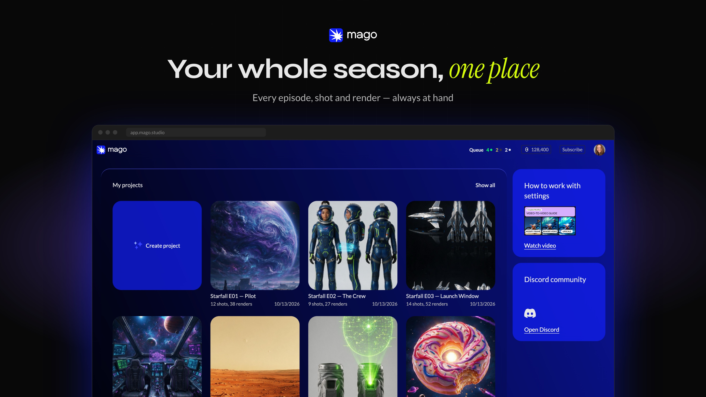
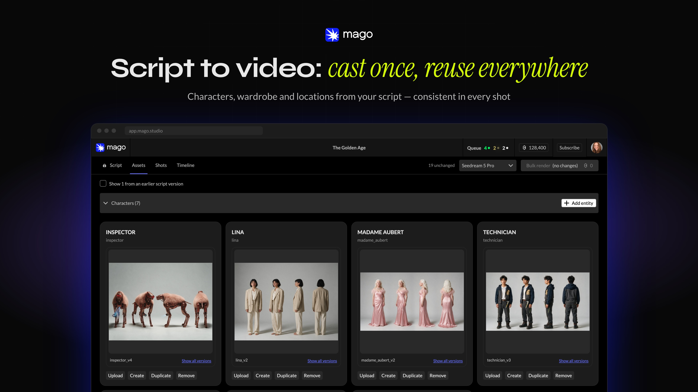
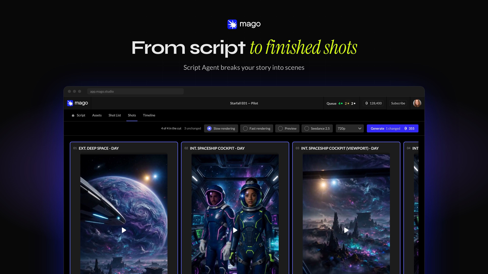
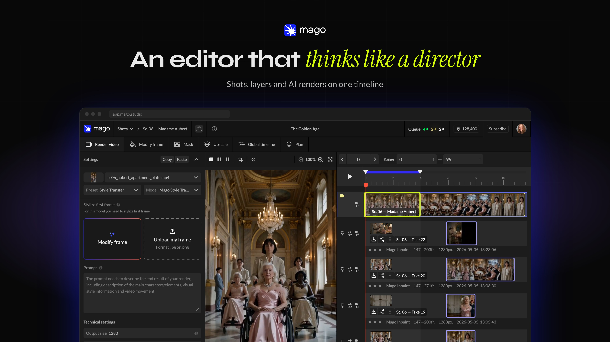

<picture>
  <source media="(prefers-color-scheme: dark)" srcset="docs-public/readme/logo-dark.svg">
  
</picture>

# Mago Studio

[](https://github.com/MagoStudio/MagoStudio/actions/workflows/ci.yml)
[](https://github.com/MagoStudio/MagoStudio/actions/workflows/format.yml)

[](https://github.com/MagoStudio/MagoStudio/releases/latest)
[](LICENSE)
[](.nvmrc)
[](https://github.com/MagoStudio/MagoStudio/releases/latest)

https://github.com/user-attachments/assets/67de7956-997a-455a-98b9-85b8215bbc78

The local-first desktop edition of the [Mago](https://mago.studio) AI video editor.
Your projects and your videos stay on your machine. Renders run on your own GPU through
ComfyUI, or in Mago Cloud when you sign in.

A Mago Cloud render uploads only what that render needs: the Shot, its source video,
reference images and masks. The rest of the Project stays local. See
[docs-public/architecture.md](docs-public/architecture.md#3-local--cloud-wiring).

## Contents

- [Features](#features)
- [Screenshots](#screenshots)
- [Made with Mago](#made-with-mago)
- [Install](#install)
- [Run from source](#run-from-source)
- [Documentation](#documentation)
- [Security](#security)
- [License](#license)

## Features

- **Mago Director.** Script to video: script, cast, shot list and storyboards, then
  consistent scenes where each Shot picks up from the previous one.
- **Mago Transform.** Footage in, restyled footage out, frame-accurate. Work on specific
  frame ranges, edit only part of a video with masks, relight, replace characters.
- **More than clips.** Versioning, real review tools and a frame-accurate pipeline.
- **Local models.** Runs on ComfyUI, with a plug-and-play bundled version, or connect
  your own install. Render on your GPU, with cloud models in the same app when you need
  them. Free to run on your own GPU; cloud models are paid and need a Mago account.
- **Made to be changed.** The code is written to be changed by AI agents. Point Claude
  at the repo and describe what you need, or add the next video model the day it comes
  out.

## Screenshots

<table>
  <tr>
    <td width="50%"></td>
    <td width="50%"></td>
  </tr>
  <tr>
    <td width="50%"></td>
    <td width="50%"></td>
  </tr>
</table>

## Made with Mago

<table>
  <tr>
    <td align="center" width="33%"><video src="https://github.com/user-attachments/assets/6689c498-a83c-4b40-a5d1-8bc9350087f0" controls width="100%"></video><br>MIFA 2026 trailer</td>
    <td align="center" width="33%"><video src="https://github.com/user-attachments/assets/e3f02418-7ee2-4990-aa93-4df40a591bdf" controls width="100%"></video><br>Mago Transform: before and after</td>
    <td align="center" width="33%"><video src="https://github.com/user-attachments/assets/64078157-651d-4502-a9a5-f4f418b304be" controls width="100%"></video><br>Mago Transform: vertical dialogue</td>
  </tr>
  <tr>
    <td align="center" width="33%"><video src="https://github.com/user-attachments/assets/cfd1fed6-3078-426d-9885-1d9bb839f2a3" controls width="100%"></video><br>Caesar, Ep. 32: The Winter Crossing</td>
    <td align="center" width="33%"><video src="https://github.com/user-attachments/assets/9111cd5e-8c98-421b-8680-ed74fc764f7b" controls width="100%"></video><br>Leo's Magic Bean, Ep. 1</td>
    <td align="center" width="33%"><video src="https://github.com/user-attachments/assets/840af4a0-01ea-473c-94b3-5489049ce58b" controls width="100%"></video><br>Ep. 2: The Wall</td>
  </tr>
</table>

## Install

Mago Studio runs on Windows, macOS and Linux. You don't need a GPU to use the app or
render in Mago Cloud. Local rendering is optional (step 3).

1. **Download** the installer for your OS from the
   [latest release](https://github.com/MagoStudio/MagoStudio/releases/latest).
   Windows builds are signed; macOS and Linux builds are unsigned.

2. **Open Mago Studio and choose how to work.**
   - **Sign in with your Mago account** to use Mago Cloud models alongside local ones.
   - **Press Skip** to work offline on your own GPU, with no account. The setup wizard
     opens for you. You can sign in later.

3. Run **Set up local rendering**. On Windows the setup wizard installs ComfyUI, node
   packs and models for you (NVIDIA GPU, 8 GB VRAM minimum, about 63 GB free disk).
   On macOS and Linux, point Mago Studio at your own ComfyUI.

> [!TIP]
> **We recommend the portable ComfyUI the wizard installs.** It comes with the right
> ComfyUI version and node packs already set up. Connecting an existing ComfyUI install
> can cause problems with mismatched nodes or Python versions.

### What the setup does

On Windows, choose **I don't have ComfyUI installed** and the wizard:

1. Checks your GPU. If it can't run local models, you can switch to Mago Cloud instead.
2. Lets you choose where to install, and checks you have enough free space.
3. Asks you to accept the model licenses.
4. Downloads ComfyUI and the models, and checks every file. You can pause and resume
   the download, or keep using the app while it runs.
5. When it's done, click **Launch ComfyUI** to start rendering.

It installs the **Minimal** group, which is everything Mago Studio needs to render with
MiniMax H3 and caption your Shots:

- **MiniMax H3**, the main video model, with a 4-step turbo LoRA for faster renders.
- **MiniMax H3 high quality**, an 8-step LoRA for higher-quality renders.
- **MiniMax H3 VFX LoRAs** for VFX edit, head swap, character swap and style transfer.
- **Qwen3-VL 4B**, which writes captions for your images and video.

The MiniMax H3 files fall under the
[MiniMax H3 Community License](https://huggingface.co/MiniMaxAI/MiniMax-H3/blob/main/LICENSE).

Script writing and reference images use Mago Cloud when you're signed in. To use them
offline, add the optional **Local LLM** and image model groups later from
**Update installation**.

**Using your own ComfyUI?** You'll need ComfyUI v0.34.0 or later, three node packs
(KJNodes, VideoHelperSuite and MiniMax-H3-PDD-Acc) and about 54 GB of models. Choose
**I already have ComfyUI** and enter its address (default `http://127.0.0.1:8188`).
The wizard lists any missing nodes and models.

## Run from source

Requires Node.js 24.15 ([`.nvmrc`](.nvmrc)) and npm 11.

```sh
npm ci
npm run dev            # Electron + Next dev server, production cloud
npm run dev:staging    # same, against the staging cloud
npm run make:desktop   # unsigned installer for the current OS
```

Checks run in CI: `npm run format:check`, `npm run lint`, `npm run type-check`,
`npm test`, `npm run build:web`, `npm run build:desktop`.

## Documentation

| Read this                                                                      | For                                                                                  |
| ------------------------------------------------------------------------------ | ------------------------------------------------------------------------------------ |
| [docs-public/architecture.md](docs-public/architecture.md)                     | Diagrams: processes, local / cloud wiring, Project kinds, model families, installers |
| [docs-public/technical-reference.md](docs-public/technical-reference.md)       | One-page map of the codebase for contributors and AI assistants                      |
| [docs-public/manual-setup.md](docs-public/manual-setup.md)                     | ComfyUI, node pack and model download links for manual setup                         |
| [CONTEXT.md](CONTEXT.md)                                                       | Domain vocabulary (Project, Shot, Track, Cloud Mirror Project…)                      |
| [docs-public/installer-user-stories.md](docs-public/installer-user-stories.md) | When and how the setup wizard opens                                                  |

## Security

Report vulnerabilities privately through GitHub — see [SECURITY.md](SECURITY.md).
Never commit credentials, environment files, real user media, signing material or
local databases.

## License

[GNU AGPL version 3 only](LICENSE). Third-party notices are in [NOTICE.md](NOTICE.md).
Open-weight models are downloaded from their authors and keep their own licenses; the
app asks you to accept the non-permissive ones before downloading.
