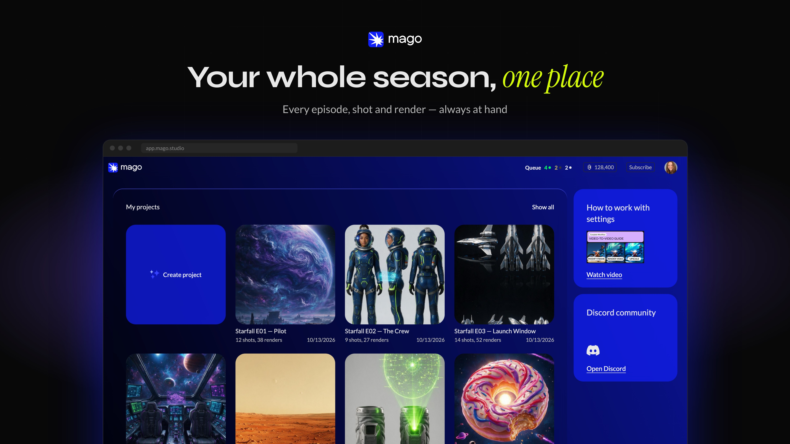
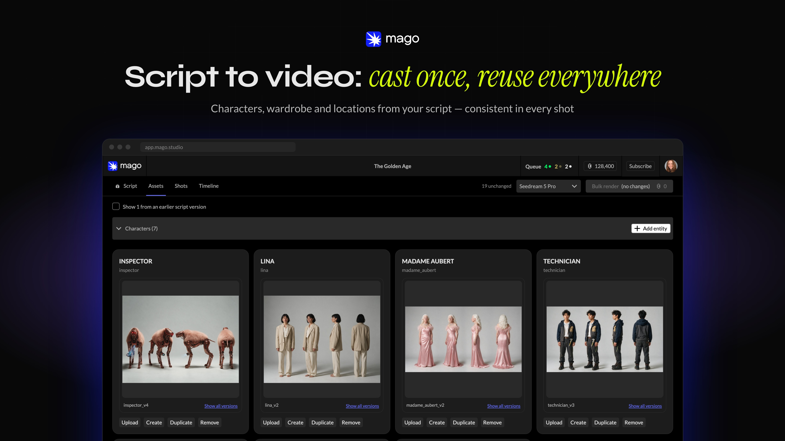
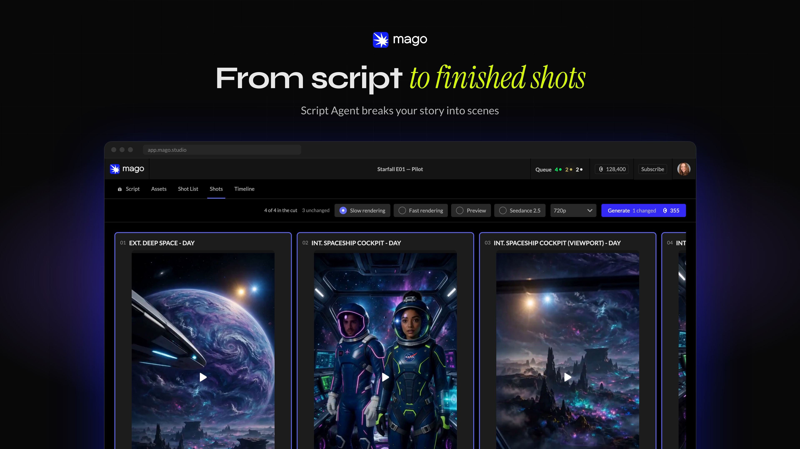
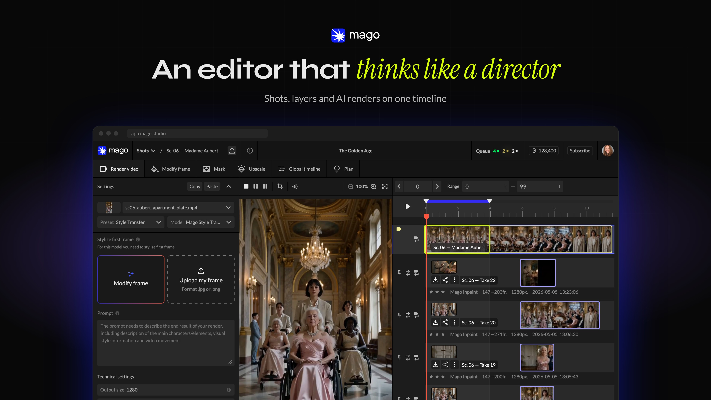

<div align="center">

<picture>
  <source media="(prefers-color-scheme: dark)" srcset="docs-public/readme/logo-dark.svg">
  
</picture>

# Mago Studio

</div>

[](README.md)
[](README_zh-CN.md)

[](https://github.com/MagoStudio/MagoStudio/actions/workflows/ci.yml)
[](https://github.com/MagoStudio/MagoStudio/actions/workflows/format.yml)

[](https://github.com/MagoStudio/MagoStudio/releases/latest)
[](https://github.com/MagoStudio/MagoStudio/releases)
[](LICENSE)
[](.nvmrc)
[](https://github.com/MagoStudio/MagoStudio/releases/latest)

https://github.com/user-attachments/assets/b85e4ffa-5d25-4cfa-be3e-74c8dd6f8a6c

[Mago](https://mago.studio) AI 视频编辑器的本地优先桌面版。你的项目和视频都保存在你自己的电脑上。渲染通过 ComfyUI 在你自己的 GPU 上运行，登录后也可以在 Mago Cloud 中运行。

Mago Cloud 渲染只会上传该次渲染所需的内容：镜头、它的源视频、参考图和蒙版。项目的其余部分保留在本地。详见 [docs-public/architecture.md](docs-public/architecture.md#3-local--cloud-wiring)。

## 目录

- [功能](#功能)
- [截图](#截图)
- [使用 Mago 制作](#使用-mago-制作)
- [安装](#安装)
- [从源码运行](#从源码运行)
- [文档](#文档)
- [安全](#安全)
- [许可证](#许可证)

## 功能

- **Mago Director。** 从剧本到视频：剧本、角色、镜头列表和分镜，然后生成连贯一致的场景，每个镜头都承接上一个镜头。
- **Mago Transform。** 输入视频素材，输出重新风格化的素材，帧级精准。可以针对指定的帧范围处理，用蒙版只编辑视频的一部分，重新打光，替换角色。
- **不只是片段。** 版本管理、真正的审阅工具，以及帧级精准的制作管线。
- **本地模型。** 基于 ComfyUI 运行，提供即插即用的内置版本，也可以连接你自己安装的 ComfyUI。在你的 GPU 上渲染，需要时也能在同一个应用里使用云端模型。在你自己的 GPU 上运行是免费的；云端模型需要付费，并且需要 Mago 账号。
- **为修改而生。** 代码专为让 AI 智能体修改而编写。把 Claude 指向这个仓库并描述你的需求，或者在下一个视频模型发布当天就把它加进来。

## 截图

<table>
  <tr>
    <td width="50%"></td>
    <td width="50%"></td>
  </tr>
  <tr>
    <td width="50%"></td>
    <td width="50%"></td>
  </tr>
</table>

## 使用 Mago 制作

<table>
  <tr>
    <td align="center" width="33%"><video src="https://github.com/user-attachments/assets/25470041-1362-47d3-a369-960bf04617fd" controls width="100%"></video><br>MIFA 2026 预告片</td>
    <td align="center" width="33%"><video src="https://github.com/user-attachments/assets/6a6730ac-6b3a-43bb-8cdc-5aab527e7d70" controls width="100%"></video><br>Mago Transform：前后对比</td>
    <td align="center" width="33%"><video src="https://github.com/user-attachments/assets/bff82dd8-4ae0-4dc3-aa62-d7a7d18404e1" controls width="100%"></video><br>Mago Transform：竖屏对话</td>
  </tr>
  <tr>
    <td align="center" width="33%"><video src="https://github.com/user-attachments/assets/465cf3fe-0bd2-4450-ac5c-7ba6ac076b3b" controls width="100%"></video><br>Caesar 第 32 集：The Winter Crossing</td>
    <td align="center" width="33%"><video src="https://github.com/user-attachments/assets/5c867bf7-98c7-401e-b6ff-c5dd46bd0c0d" controls width="100%"></video><br>Leo's Magic Bean 第 1 集</td>
    <td align="center" width="33%"><video src="https://github.com/user-attachments/assets/17c5827b-496a-488f-b4d7-65216c00ea16" controls width="100%"></video><br>第 2 集：The Wall</td>
  </tr>
</table>

## 安装

Mago Studio 支持 Windows、macOS 和 Linux。使用应用或在 Mago Cloud 中渲染都不需要 GPU。本地渲染是可选的（第 3 步）。

1. **下载**：从 [最新发布版本](https://github.com/MagoStudio/MagoStudio/releases/latest) 下载适用于你操作系统的安装程序。Windows 版本已签名；macOS 和 Linux 版本未签名。

2. **打开 Mago Studio，选择工作方式。**
   - **登录你的 Mago 账号**，即可同时使用 Mago Cloud 模型和本地模型。
   - **点击 Skip**（跳过），无需账号即可离线使用你自己的 GPU 工作。安装向导会自动打开。你之后可以再登录。

3. 运行 **Set up local rendering**（设置本地渲染）。在 Windows 上，安装向导会为你安装 ComfyUI、自定义节点和模型（需要 NVIDIA GPU、至少 8 GB 显存、约 63 GB 可用磁盘空间）。在 macOS 和 Linux 上，请将 Mago Studio 连接到你自己的 ComfyUI。

> [!TIP]
> **我们推荐使用安装向导安装的便携版 ComfyUI。** 它自带正确的 ComfyUI 版本，自定义节点也已经配置好。连接已有的 ComfyUI 可能会因节点不匹配或 Python 版本不一致而出现问题。

### 安装向导会做什么

在 Windows 上，选择 **I don't have ComfyUI installed**（我还没有安装 ComfyUI），安装向导会：

1. 检查你的 GPU。如果无法运行本地模型，你可以改用 Mago Cloud。
2. 让你选择安装位置，并检查可用空间是否足够。
3. 请你接受模型许可证。
4. 下载 ComfyUI 和模型，并校验每个文件。你可以暂停和继续下载，也可以在下载过程中继续使用应用。
5. 完成后，点击 **Launch ComfyUI**（启动 ComfyUI）开始渲染。

它会安装 **Minimal**（最小）组，其中包含 Mago Studio 使用 MiniMax H3 渲染和为镜头生成描述所需的全部内容：

- **MiniMax H3**，主视频模型，附带一个 4 步加速 LoRA，渲染更快。
- **MiniMax H3 高质量版**，一个 8 步 LoRA，渲染质量更高。
- **MiniMax H3 VFX LoRA**，用于特效编辑、换头、角色替换和风格迁移。
- **Qwen3-VL 4B**，为你的图片和视频生成描述。

MiniMax H3 相关文件遵循 [MiniMax H3 社区许可证](https://huggingface.co/MiniMaxAI/MiniMax-H3/blob/main/LICENSE)。

登录后，剧本写作和参考图会使用 Mago Cloud。如需离线使用，之后可以在 **Update installation**（更新安装）中添加可选的 **Local LLM**（本地大语言模型）组和图像模型组。

**使用你自己的 ComfyUI？** 你需要 ComfyUI v0.34.0 或更高版本、三个自定义节点（KJNodes、VideoHelperSuite 和 MiniMax-H3-PDD-Acc），以及约 54 GB 的模型。选择 **I already have ComfyUI**（我已经安装了 ComfyUI）并输入它的地址（默认为 `http://127.0.0.1:8188`）。安装向导会列出所有缺失的节点和模型。

## 从源码运行

需要 Node.js 24.15（[`.nvmrc`](.nvmrc)）和 npm 11。

```sh
npm ci
npm run dev            # Electron + Next 开发服务器，连接生产环境云端
npm run dev:staging    # 同上，连接预发布（staging）环境云端
npm run make:desktop   # 为当前操作系统构建未签名的安装程序
```

CI 中运行的检查：`npm run format:check`、`npm run lint`、`npm run type-check`、`npm test`、`npm run build:web`、`npm run build:desktop`。

## 文档

| 文档                                                                           | 内容                                                      |
| ------------------------------------------------------------------------------ | --------------------------------------------------------- |
| [docs-public/architecture.md](docs-public/architecture.md)                     | 图示：进程、本地 / 云端连接、项目类型、模型系列、安装程序 |
| [docs-public/technical-reference.md](docs-public/technical-reference.md)       | 面向贡献者和 AI 助手的代码库单页概览                      |
| [docs-public/manual-setup.md](docs-public/manual-setup.md)                     | 手动设置所需的 ComfyUI、自定义节点和模型下载链接          |
| [CONTEXT.md](CONTEXT.md)                                                       | 领域术语表（Project、Shot、Track、Cloud Mirror Project…） |
| [docs-public/installer-user-stories.md](docs-public/installer-user-stories.md) | 安装向导何时以及如何打开                                  |

## 安全

请通过 GitHub 私下报告漏洞，详见 [SECURITY.md](SECURITY.md)。切勿提交凭据、环境文件、真实用户媒体、签名材料或本地数据库。

## 许可证

[仅限 GNU AGPL 第 3 版](LICENSE)。第三方声明见 [NOTICE.md](NOTICE.md)。开放权重模型从其作者处下载，并保留各自的许可证；在下载采用非宽松许可证的模型前，应用会请你先接受相应许可证。
