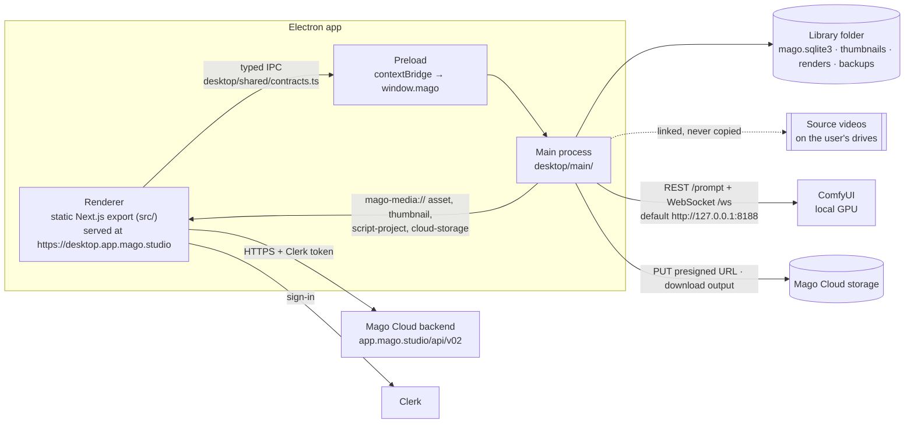
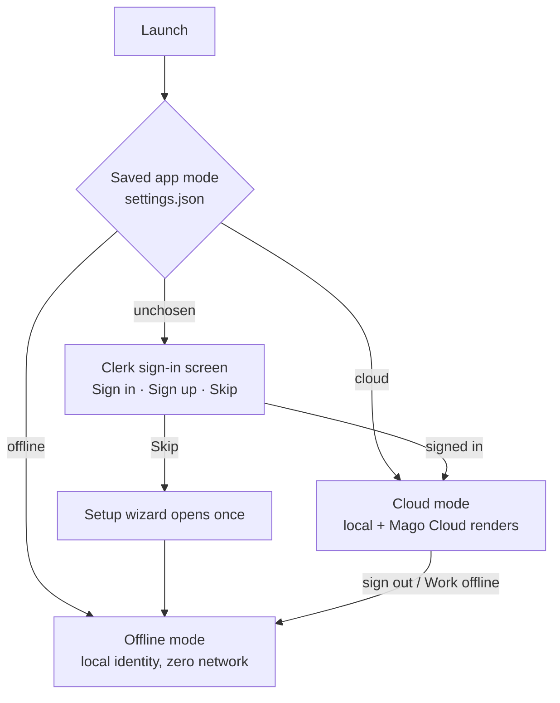
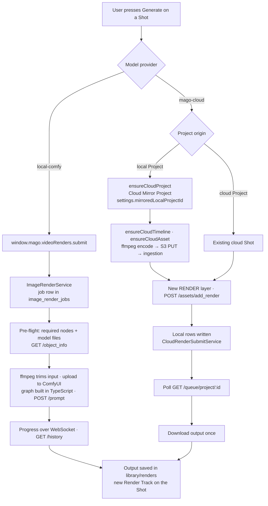
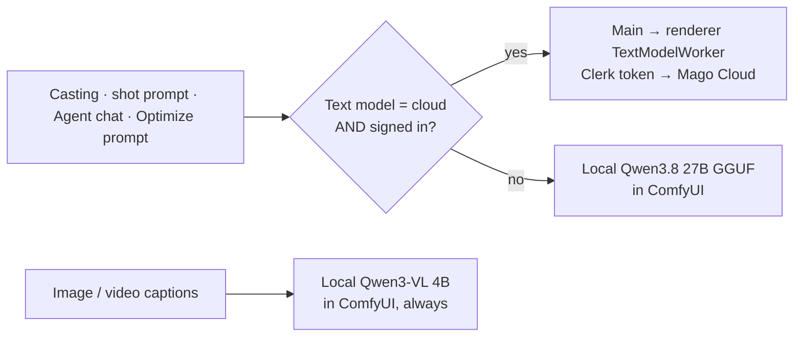
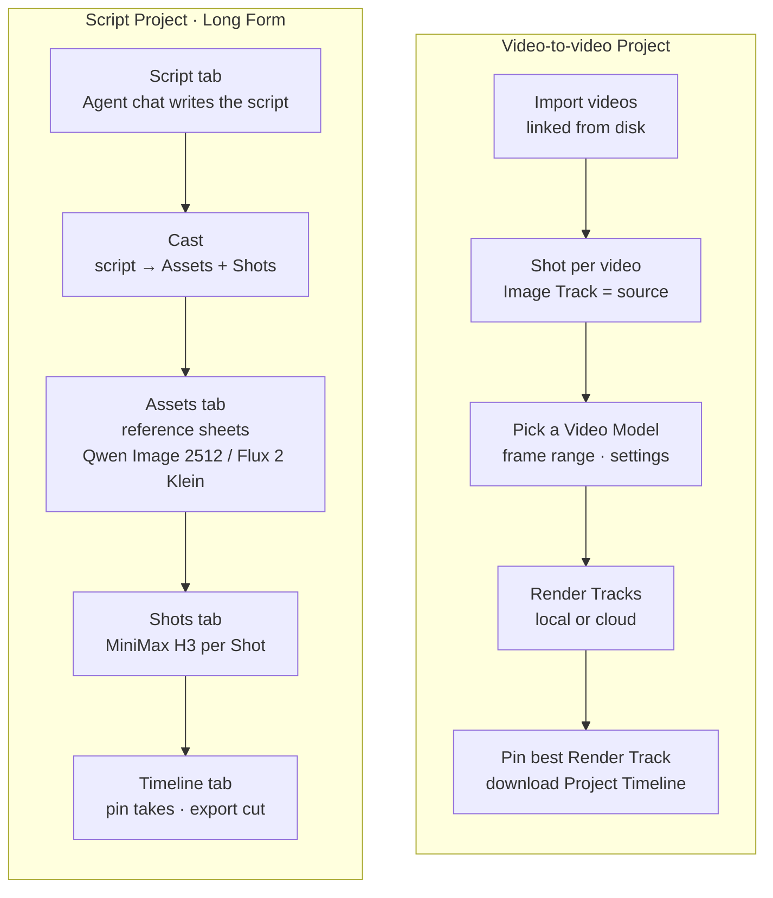
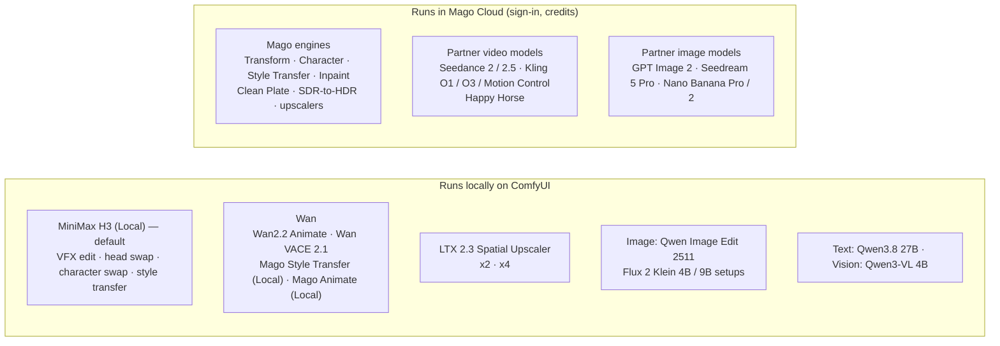
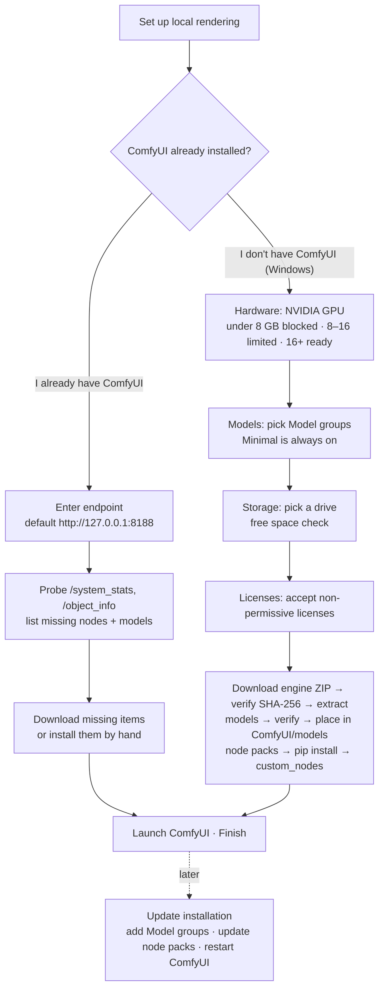
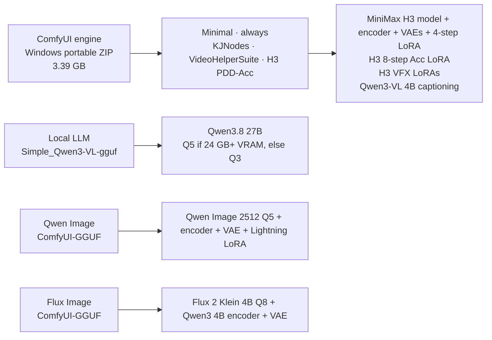

# Mago Studio architecture

Diagrams of how Mago Studio fits together. Terms follow [CONTEXT.md](../CONTEXT.md).
For file-level detail, see [technical-reference.md](technical-reference.md). For download
links, see [manual-setup.md](manual-setup.md).

## 1. Processes

Mago Studio is an Electron shell around the static export of the Mago web frontend. Only
the main process touches the disk, SQLite and ComfyUI. The renderer reaches them through
the typed `window.mago` API. Only the renderer talks to the Mago Cloud backend, because it
holds the Clerk session.

**The renderer origin is real HTTPS.** A host-resolver rule maps
`desktop.app.mago.studio` to a loopback TLS listener (port 47821) with a pinned
per-install certificate. Clerk needs a genuine subdomain to sign in.

**One frontend, two builds.** Files named `*.local.ts(x)` shadow their cloud twin at build
time (`next.config.mjs`), so the same component tree runs in the web app and on the desktop.

## 2. App modes and sign-in

Offline mode makes no network request at all.

## 3. Local / cloud wiring

**Local or cloud is a property of the model, not of the build or the Project.** The
provider of each model is `local-comfy` or `mago-cloud` (`src/platform/modelProviders.ts`).

A local Project uploads
nothing, except the inputs a cloud render needs. Those inputs run in a hidden
**Cloud Mirror Project**, one per local Project, linked in the `cloud_links` table.

**What a Mago Cloud render of a local Project uploads:**

- **Mirrored, for that render only**: the Shot being rendered, its source video (trimmed
  to the clip actually used), its reference images and masks, and the render settings.
  The Project, Shot and file names go with them.
- **Never mirrored**: the rest of the Project — other Shots, other source videos, local
  Render Tracks, folders, and the Script Project's script document.
- **Mirrored once, then reused**: an asset already uploaded for an earlier render is not
  uploaded again.
- **Cloud text model**: with Text model set to cloud, casting, shot prompts and Agent
  chat send their text to Mago Cloud. That creates no cloud Project.
- **Signed-out or offline**: nothing is uploaded at all.

**The cloud is a write path plus one download.** Everything the UI displays is read from
the local library. A finished cloud render becomes an ordinary local asset.

**Cloud Projects work as in the web app.** A Project created with destination
**Mago Cloud** lives in the cloud and is mirrored into the library. Edits and new assets
go back to the cloud.

### Text and vision models

A cloud error is shown to the user. Nothing silently falls back to local.

## 4. Project kinds

| Kind                   | `type`            | Route             | UI name                       |
| ---------------------- | ----------------- | ----------------- | ----------------------------- |
| Video-to-video Project | `timeline`        | `/project`        | Transform your own videos     |
| Script Project         | `script_to_shots` | `/script-project` | Script-to-movie ("Long Form") |

Both kinds share the data model: **Project → Shot → Track → Clip → Asset**. The backend
and the database call a Shot a _timeline_ and a Track a _layer_.

## 5. Model families

Presets all point at Mago Cloud models. The full list with ids is in
[technical-reference.md](technical-reference.md#models).

## 6. Installers and setup

### Setup wizard (local rendering)

### What each Model group installs

Every file and node pack is pinned by SHA-256. Links are in [manual-setup.md](manual-setup.md).
