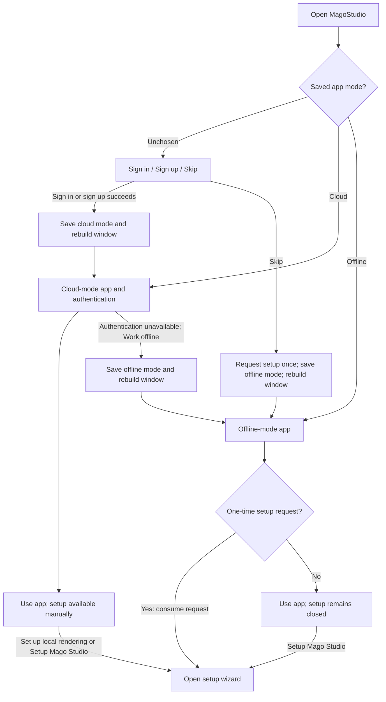
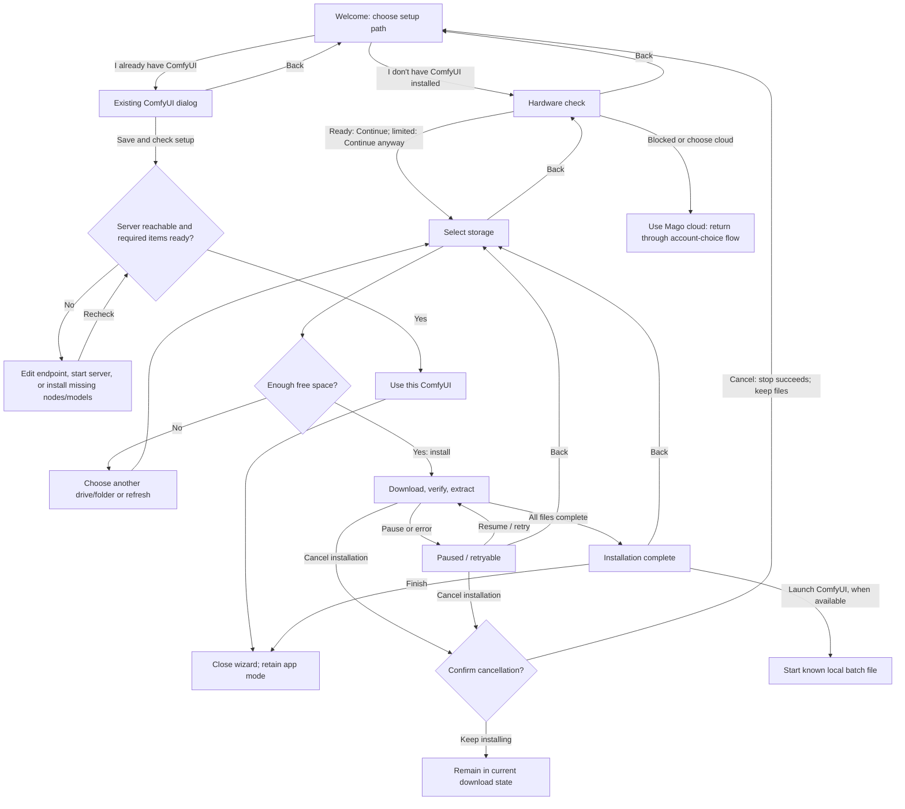
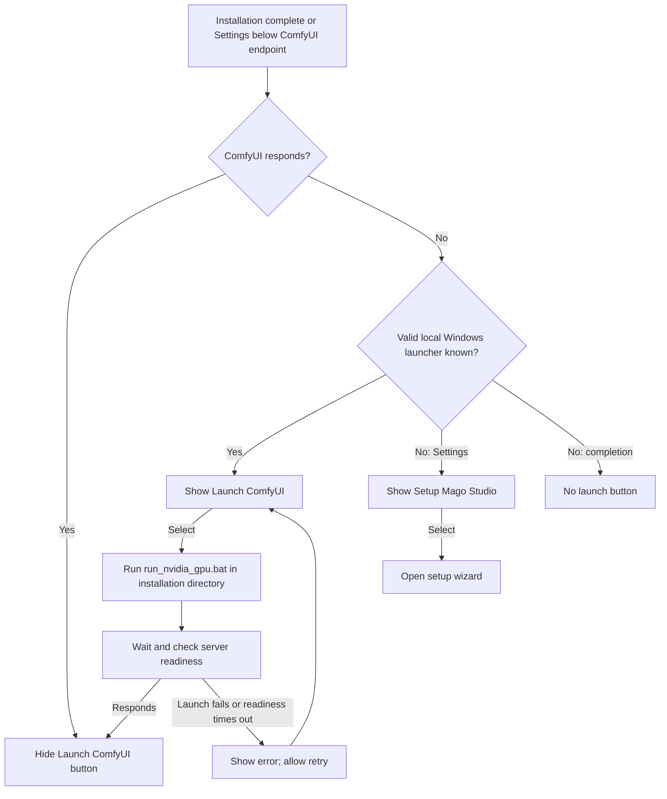

# MagoStudio installer user stories

These flows describe existing behavior, including cases where setup does not open automatically.

## When is the installer shown?

MagoStudio remembers an app mode: **cloud**, **offline**, or **unchosen**. Cloud sign-in and local installation are separate states. Offline mode works without a cloud account; its internal local identity must not be confused with a cloud login.

| User situation                                                         | What appears                              | Installer behavior                                                                                              |
| ---------------------------------------------------------------------- | ----------------------------------------- | --------------------------------------------------------------------------------------------------------------- |
| First launch, no mode chosen                                           | Sign-in / sign-up screen with **Skip**    | Hidden until the user chooses a path.                                                                           |
| User signs in or signs up at that screen                               | Cloud-mode app                            | Does not open automatically.                                                                                    |
| User selects **Skip**                                                  | Offline-mode app                          | Opens automatically once, after the app window rebuilds.                                                        |
| Returning user, saved offline mode                                     | Offline-mode app                          | Does not automatically reopen, even if installation is incomplete.                                              |
| Returning user, saved cloud mode                                       | Cloud-mode app / authentication flow      | No automatic installer request.                                                                                 |
| Cloud authentication is unavailable; user selects **Work offline**     | Offline-mode app                          | Does not open automatically. This action does not use the Skip handoff.                                         |
| User selects **Set up local rendering** on the dashboard               | Setup wizard                              | Manual entry, shown in cloud mode while the wizard is closed. The card is not gated by installation completion. |
| Local rendering is not ready in render controls                        | **Setup Mago Studio** instead of Generate | Selecting it opens the wizard in either app mode.                                                               |
| ComfyUI is unavailable in Settings and cannot be launched              | **Setup Mago Studio** below the endpoint  | Selecting it opens setup.                                                                                       |
| ComfyUI is unavailable in Settings but a valid local launcher is known | **Launch ComfyUI** below the endpoint     | Launches the server instead of reopening the installer.                                                         |

Automatic opening uses a one-time flag from **Skip**. Neither cloud login status nor missing installation alone causes automatic opening.

Sources: [sign-in gate](../src/app/components/SignInGate/SignInGate.tsx), [one-time handoff](../src/app/components/LocalSetupWizard/localSetupWizardHandoff.ts), [wizard host](../src/app/components/LocalSetupWizard/LocalSetupWizardHost.tsx), [cloud unavailable notice](../src/app/components/CloudReady/CloudUnavailableNotice.tsx), [dashboard entry](<../src/app/(authenticated)/(home)/components/dashboard/RunLocallyCard.tsx>).

## User stories and acceptance behavior

| Story                                   | User need                                                                                                   | Observable behavior                                                                                                                                               |
| --------------------------------------- | ----------------------------------------------------------------------------------------------------------- | ----------------------------------------------------------------------------------------------------------------------------------------------------------------- |
| US-01 — Start without login             | As a new user, I want to skip cloud sign-in so I can set up local rendering.                                | Skip enters offline mode and opens the wizard once.                                                                                                               |
| US-02 — Add local rendering after login | As a cloud user, I want to install local rendering without changing my account mode.                        | The dashboard setup action opens the same wizard; completion does not switch modes.                                                                               |
| US-03 — Reuse ComfyUI                   | As an existing ComfyUI user, I want to connect my server so I can avoid a second installation.              | Save and check setup validates the endpoint and requirements; **Use this ComfyUI** completes setup only when ready.                                               |
| US-04 — Change setup choice             | As a user who finds existing-server setup too complex, I want to go back and choose automated installation. | **Back** in the existing ComfyUI dialog returns to the welcome choices and keeps the wizard open.                                                                 |
| US-05 — Install automatically           | As a user without ComfyUI, I want hardware and disk checks before downloads begin.                          | **I don't have ComfyUI installed** checks hardware, then storage; installation starts only with enough free space in the selected destination.                    |
| US-06 — Change destination              | As a user, I want to revisit earlier steps without losing my choices.                                       | Back from Storage returns to the hardware result; the selected storage location remains remembered.                                                               |
| US-07 — Pause or stop                   | As a user, I want control over a large download so I can continue later.                                    | Pause stops the active run; Resume / retry continues. Confirmed cancellation returns to welcome and keeps downloaded files for reuse in the same folder.          |
| US-08 — Explore during installation     | As a user, I want to browse the app while installation continues.                                           | **Explore Mago while you wait** collapses setup to a progress pill; opening the pill restores the wizard. Guarded render actions show a setup-in-progress notice. |
| US-09 — Start installed ComfyUI         | As a user who completed installation, I want to start ComfyUI without locating its batch file.              | Completion offers **Launch ComfyUI** when the server is stopped and a valid launcher is available, plus **Finish** to close setup.                                |
| US-10 — Restart ComfyUI later           | As a returning user, I want to start my stopped server from Settings.                                       | Settings shows **Launch ComfyUI** below the endpoint when launchable and unavailable; the button disappears once the server responds.                             |

## Setup choices, Back, and completion

Back is available on Hardware check and Storage. On Download, Back is disabled while downloading, verifying, or extracting; pause first to return to Storage. A failed or completed download also permits Back. Storage submission temporarily disables navigation.

The existing-server path requires the minimum nodes and models; optional requirements do not block completion. Automated setup installs ComfyUI, MiniMax (including its 8-step LoRA), and Qwen-VL. Text and image generation use Mago cloud by default, so completing local setup does not make every feature usable without cloud access.

Sources: [wizard flow](../src/app/components/LocalSetupWizard/hooks/useLocalSetupWizardFlow.ts), [existing ComfyUI dialog](../src/app/components/LocalSetupWizard/LocalSetupExistingComfyDialog.tsx), [download and cancellation](../src/app/components/LocalSetupWizard/LocalSetupDownloadStep.tsx).

## Launch ComfyUI after setup or from Settings

Launching is supported for a local Windows installation and a loopback endpoint. The app uses a validated inferred existing installation or a verified installer-managed installation. A remote ComfyUI endpoint cannot be started through a batch file on this machine. Launching does not create another process if the server is already available or a launched process is still tracked.

Setup completion does not start ComfyUI automatically. Launch waits for readiness and reports failure if the server does not respond within its startup window.

Sources: [launch button](../src/app/components/LaunchComfyButton/index.tsx), [launch readiness hook](../src/app/components/LaunchComfyButton/hooks/useLaunchComfy.ts), [native batch launcher](../desktop/main/comfy/ComfyLauncher.ts), [Settings integration](<../src/app/(authenticated)/(home)/components/Navbar/UserMenu.local.tsx>).

## Installation in progress and account changes

Collapsing the wizard keeps installation running in the desktop process. A guarded render action opens **Your local setup is still running**, with **Keep waiting** or **Connect Mago cloud**. Connecting cloud returns through the account-choice flow; a window rebuild can interrupt the active run, but downloaded files remain available for resuming.

Signing in from offline mode switches to cloud mode without requesting the installer. Signing out clears the saved mode and returns to the account-choice gate. Selecting Skip there requests setup again, even if a previous installation already exists.

Sources: [setup-in-progress dialog](../src/app/components/LocalSetupWizard/LocalSetupInProgressDialog.tsx), [account mode handlers](../desktop/main/ipc/registerAccountHandlers.ts).
